# [Good Article Sharing] STNet: A Spatio-Temporal Network Solution for Fast and Accurate DoA Estimation of Car Radar Pulses with No Grid Structure

Introduction: Autonomous driving technology is an integral part of future intelligent transportation systems. "Current research suggests that this process requires the participation and fusion of multiple sensors. Millimeter-wave radar, as a type of all-weather sensor with long-range detection capabilities, has outstanding advantages and will play a crucial role in achieving rapid and accurate target detection by onboard radar. To achieve real-time, super-resolution direction of arrival (DOA) estimation for vehicle-mounted radar, it is necessary to have real-time, ultra-resolution waveform direction of arrival (DOA) estimation algorithms, which is also a pressing issue in array signal processing, especially for forward-looking vehicle-mounted radar [1]. For example, for applications such as distant target detection, localization, imaging, etc., there is a high demand for DOA estimation accuracy. Similarly, in vehicle-mounted radar systems, vehicles often travel at high speeds, which also requires real-time DOA estimation. Additionally, in practical applications, only a few snapshots are available for coherent processing. Therefore, finding a low computational complexity method that can utilize small snapshots to achieve super-resolution DOA estimation is crucial for many real-world scenarios.
Over the past few years, a large number of different DOA estimation algorithms have been proposed. The traditional beamforming based on Fourier spectrum analysis is an early DOA estimation method [2] with its angle resolution limited by the Rayleigh limit [3]. Therefore, it cannot achieve super-resolution estimation. Since the 1980s, methods based on subspace have attracted more attention [4], [5]. The most representative methods are the Multiple Signal Classification (MUSIC) method and the Eigenvector Transform Based Inversion (ESPRIT) method through rotationally invariant signal parameters [5]. They can break through the Rayleigh limit to achieve super-resolution estimation, but they also have some limitations. These algorithms are generally model-based methods, usually requiring a large amount of sampled snapshots to achieve precise estimation. Moreover, their computational burden is quite high, which does not meet practical applications [6].
Production of the product based on full-angle spatial sparsity representation is also a research hotspot in recent years to achieve super-resolution performance. These methods based on sparse representation can generally be divided into three categories: grid-based, off-grid and meshless methods [8]. Grid-based methods usually use predefined discrete grids as dictionaries to recover collision sparse signals in the angle space from received signals, such as L1-SVD [9], Sparse Bayesian Learning (SBL) [10] and Sparse Iterative Covariance Estimation (SPICE) [11]. The above methods assume that the arrival direction of the incident signal is located on a determined discrete grid, but in reality, the actual signal's arrival direction always has a gap with its nearest grid point, and the estimation accuracy is directly related to the grid resolution. Against this backdrop, off-grid methods further consider the off-grid error in the model to narrow the gap, and achieve better DOA estimation performance by correcting the dictionary. The introduction of the Sparse Total Least Squares (STLS) method [12] to solve the perturbation of the regression matrix has an important impact on the DOA estimation problem. However, this method assumes that the matrix perturbation caused by mismatched bases is Gaussian, which is not suitable for real DOA estimation [13]. In literature [14], a model based on first-order Taylor expansion is proposed to solve the off-grid DOA estimation problem, where it assumes that the off-grid distance satisfies a consistent prior. In literature [15], a strategy using Noise Subspace Fitting (NSF) is proposed, which extends the first-order Taylor approximation to the second-order Taylor approximation to achieve higher modeling accuracy. The above off-grid methods still need relatively fine grids to ensure smaller errors to achieve good estimation effects, which will lead to increased computational complexity. Therefore, later methods such as grid evolution methods [16], [17] were proposed, which take predefined discrete grids as adjustable parameters, which improves the estimation performance when using coarse grids. Subsequently, meshless methods appeared, which operate directly in the continuous domain, thus avoiding the issue of grid mismatch. Representative methods usually based on atomic norms [18], [19], [20], [21], [22], which achieve better performance at the cost of very high computational complexity. These sparse representation-based schemes rely on established models and often require assumptions about prior information, which is difficult to obtain in practical applications. When the model contains errors or the assumed prior information is not suitable, it may lead to inaccurate estimation results. Moreover, methods like atomic norm minimization (ANM) require iterative optimization of a large number of parameters, resulting in prolonged computation time and making real-time estimation difficult.
Machine learning has also been introduced into the DOA estimation problem, becoming an important research direction. Support Vector Classification (SVC) [23] and Support Vector Regression (SVR) [24], [25], [26] are representative examples. Generally speaking, SVC completes DOA estimation through classification tasks, while SVR performs regression tasks, achieving gridless estimation. In recent years, deep learning (DL) methods in DOA estimation have become a hot research topic, showing unique advantages different from previous methods. As a data-driven algorithm, it does not rely on pre-established models, avoiding errors and limitations brought by the model. Moreover, after network training is completed, performing estimation tasks only requires simple calculations during execution, making it more suitable for practical scenarios. Finally, DL methods have good adaptability to data defects, demonstrating better stability under low signal-to-noise ratio or array deficiencies.
In [28], a deep neural network is proposed to estimate the signal DOA, assuming a required resolution of 1 μs. Each output value is defined as representing the probability that the signal enters at an angle corresponding to the respective angle. However, the results indicate that the success rate for precise DOA estimation is quite low in near-DOA scenarios. Similarly, in [29], a DNN framework consisting of a multi-task autoencoder (AE) and multiple parallel classifiers is used for DOA estimation under different array defect conditions. In [30], a deep convolutional neural network (CNN) is proposed for DOA estimation using sparse priors under low SNR. However, due to the use of one-dimensional convolutional filters, experimental results did not show significant performance gains [31]. In [31], another CNN structure was introduced and improved the performance of DOA estimation under low SNR. However, since the training uses an ideal covariance matrix, its performance will be severely affected when the number of snapshots decreases. At the same time, it is also difficult to perform DOA estimation under fewer snapshots. In [32], a DeepMUSIC framework with multiple CNNs is proposed, each CNN learning the MUSIC spectrum of a subregion corresponding to an angle. Although this framework has lower computational complexity compared to the MUSIC algorithm, the results indicate that its estimation accuracy is largely limited by the MUSIC algorithm, making it difficult to achieve significant improvements.
(1) We model DOA estimation as a new regression task rather than a multi-label classification problem. The network's output directly reflects the signal's incident angle and is treated as a continuous variable, achieving gridless estimation.
(2) The purpose of the Spatio-Temporal Network (STNet) framework is to combine the spatial and temporal characteristics of different sources of impact arrays from joint harvesters, producing better estimation results compared to existing state-of-the-art methods with fewer snapshots.
(3) A spatially-correlated extraction module (SCEM) was proposed, which takes the estimated covariance matrix as input to highlight the spatial path differences caused by signal incidence angles and different array element positions. By retaining high-resolution features in the initial covariance matrix, a dense layer with leap connections is used to enhance the resolution of small-angle interval targets.
Article illustration
Conclusion: A new deep learning network framework for super-resolution direction of arrival (DOA) estimation under small snapshot conditions was proposed. The SCEM and TCEM modules were designed to process data from the original sampling signal and the estimated covariance matrix of the received signal. A SCDB structure was introduced to improve the network's resolution for small-interval targets, and an LSTM structure was employed for time-related feature extraction. Subsequently, features extracted by the two modules were processed through a series of FC layers, where STNet modeled DOA estimation as a regression problem to achieve gridless estimation. Therefore, different features were obtained and combined for DOA estimation. This method not only provides more information for DOA estimation in small snapshots but also enhances the accuracy of the regression task through additional information. Experimental results show that compared to previous DL methods, STNet achieved gridless estimation effects, and its estimation accuracy was not limited by grid resolution. In the case of small snapshots, it demonstrated more favorable estimation performance. At the same time, it retained the advantages of DL-based methods, offering stronger adaptability than traditional methods and maintaining good estimation performance even in situations where the signal arrival angle is very close to zero and the signal-to-noise ratio is low.

## Images

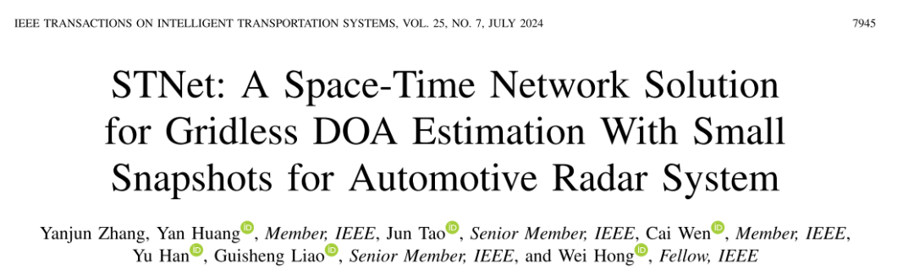
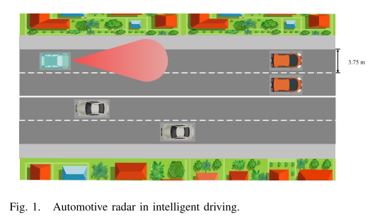
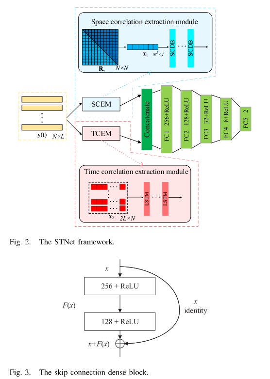
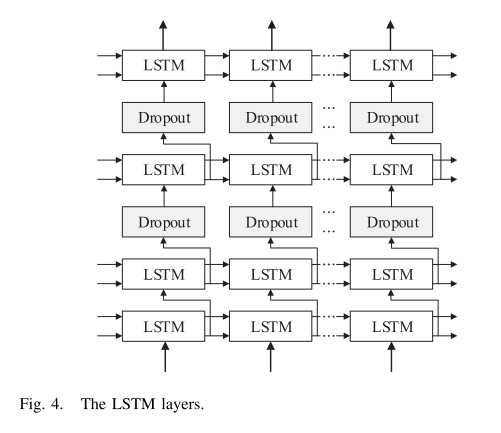
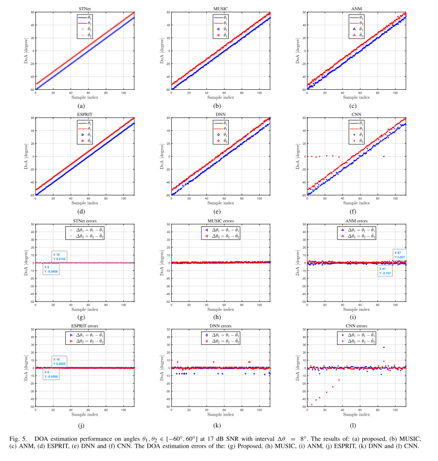
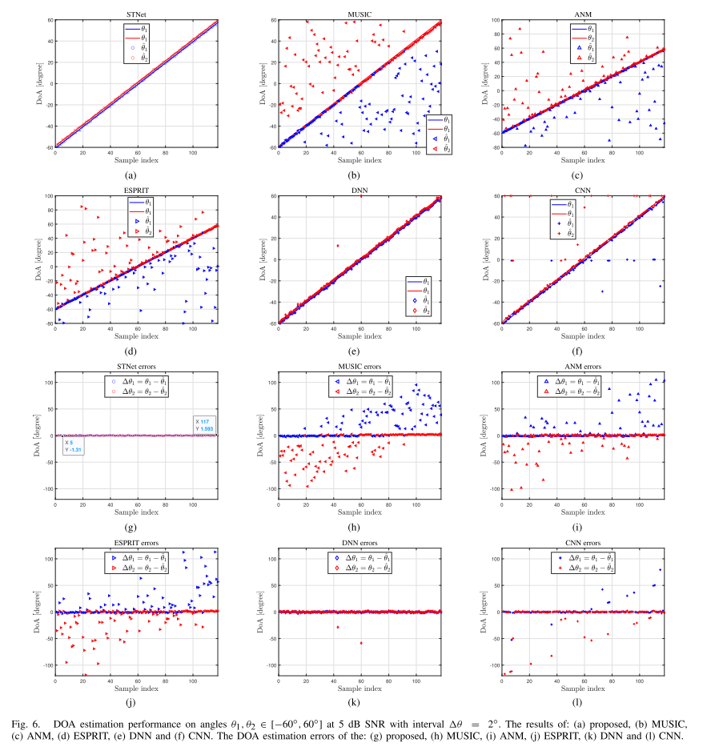
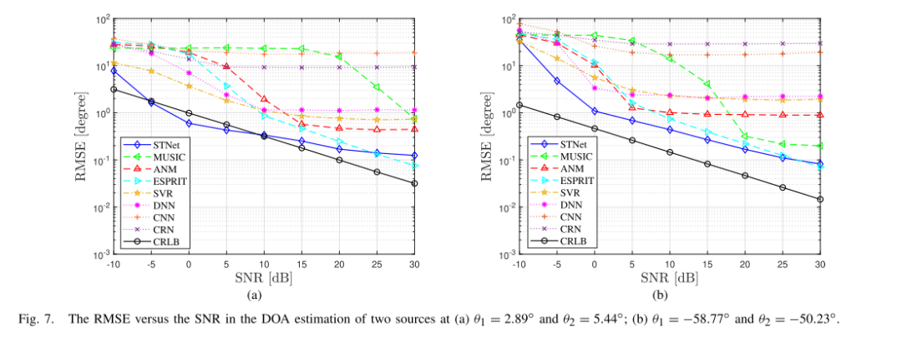
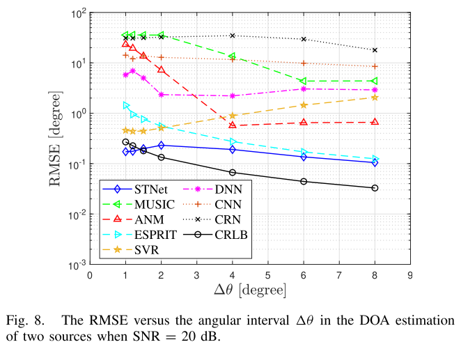
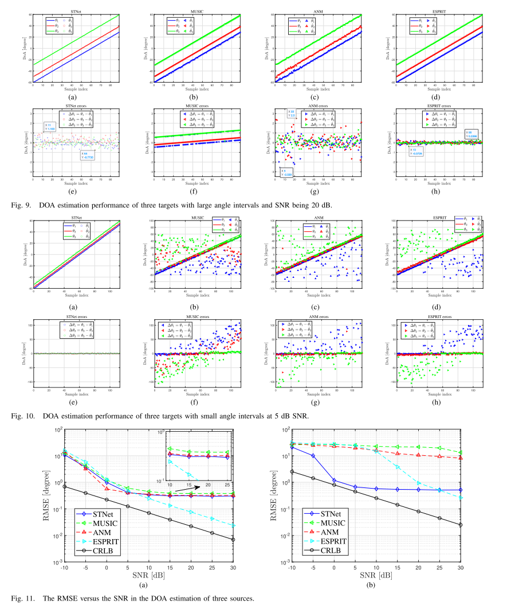
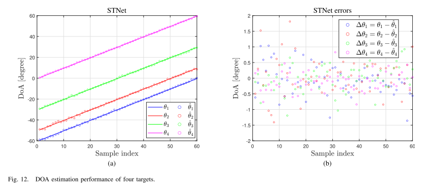
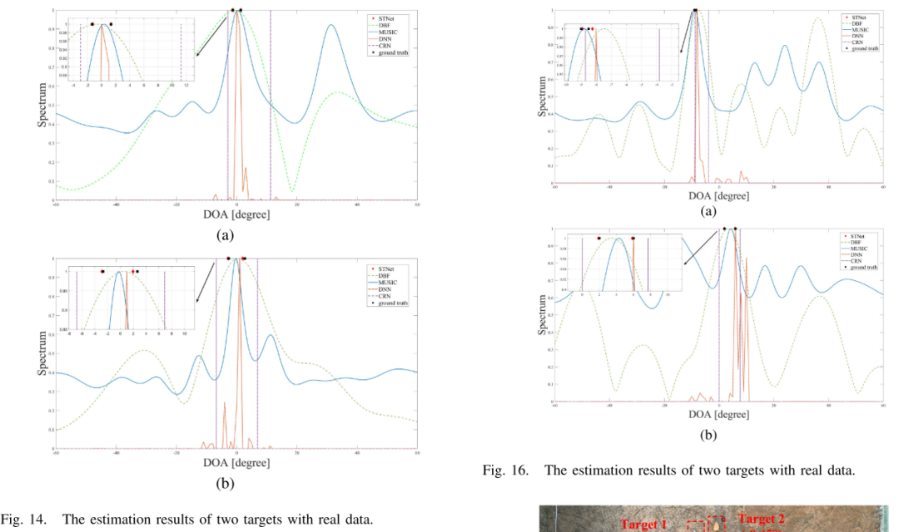

<!-- PAYMENT_BLOCK -->

## Get this dataset

- Payment link (Stripe): [Buy now](https://buy.stripe.com/3cs8yP7sY87d0vu9AB)
- Payment QR code: 

<!-- /PAYMENT_BLOCK -->
